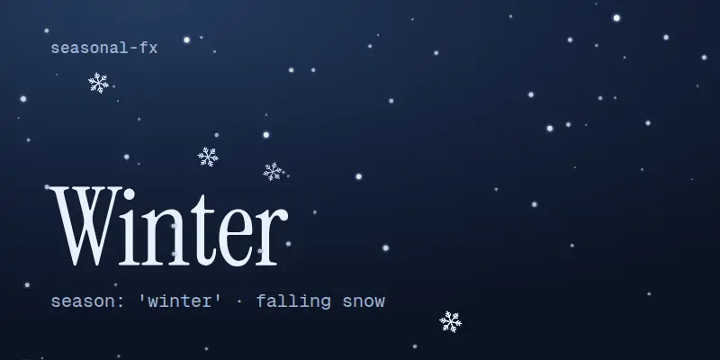
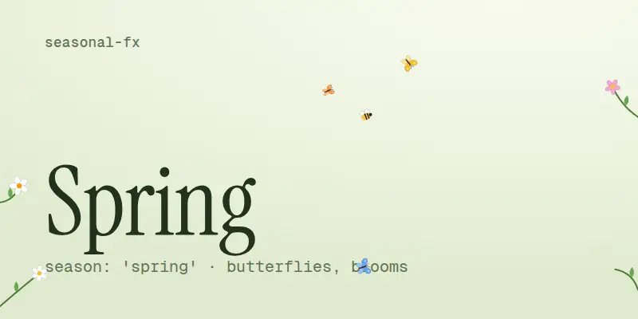
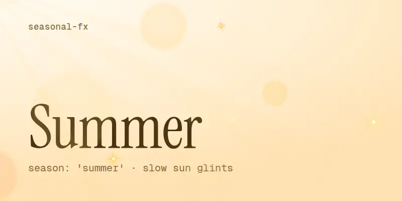
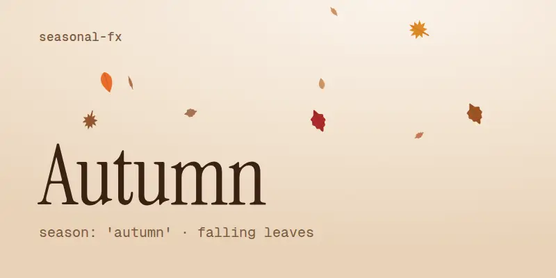

<div align="center">

# seasonal-fx

**Seasonal background effects for any website: falling snow, spring butterflies and blooming flowers, slow summer sun glints, falling autumn leaves.**

Zero dependencies · ~11 KB gzip · React, Next.js, Vue, Svelte, Astro or a single `<script>` tag

[Live demo](https://seasonal-fx.vercel.app) · [npm](https://www.npmjs.com/package/seasonal-fx) · [Recipes](docs/recipes.md) · [For AI assistants](AGENTS.md)

</div>

<table>
  <tr>
    <td></td>
    <td></td>
  </tr>
  <tr>
    <td></td>
    <td></td>
  </tr>
</table>

## Seasons

| `season` | What you see |
| --- | --- |
| `winter` | Falling snow with depth: small far flakes, larger near ones, a few rotating six-armed crystals, gentle wind. Visible on dark and light backgrounds. |
| `spring` | Butterflies that flutter in, wander and leave; a bee visiting flowers; small flowers that grow from the left and right edges, bloom, sway and fade. |
| `summer` | Slow, warm lens bokeh, four-point sun glints that twinkle in and out, faint light rays from the top-left corner. |
| `autumn` (or `fall`) | Maple, oak and beech leaves that tumble, sway and show a darker back side when they flip. |
| `auto` (default) | Picks one of the above from today's date. Set `hemisphere: 'south'` for Australia, South America, southern Africa. |

## Install

```bash
npm install seasonal-fx
# pnpm add seasonal-fx · yarn add seasonal-fx · bun add seasonal-fx
```

## Quick start

### React / Next.js

```tsx
// app/layout.tsx (Next.js App Router) or your root component
import { SeasonalEffect } from 'seasonal-fx/react'

export default function RootLayout({ children }: { children: React.ReactNode }) {
  return (
    <html lang="en">
      <body>
        {children}
        <SeasonalEffect />                 {/* season from today's date */}
        {/* <SeasonalEffect season="winter" /> */}
      </body>
    </html>
  )
}
```

The component is marked `'use client'`, so it can sit in a Server Component layout.

### Plain HTML (no build step)

```html
<script type="module"
        src="https://cdn.jsdelivr.net/npm/seasonal-fx/dist/auto.js"
        data-seasonal-fx
        data-season="auto"></script>
```

Data attributes: `data-season`, `data-hemisphere`, `data-density`, `data-speed`, `data-z-index`, `data-colors` (comma separated). The controller is available as `window.seasonalFx`.

### Any framework (vanilla API)

```js
import { createSeasonalEffect } from 'seasonal-fx'

const fx = createSeasonalEffect({ season: 'autumn' })

fx.setSeason('winter') // cross-fades
fx.pause()
fx.resume()
fx.destroy()           // removes the canvas
```

Vue, Svelte, Astro, Angular, WordPress and more: see [docs/recipes.md](docs/recipes.md).

## Options

| Option | Type | Default | Notes |
| --- | --- | --- | --- |
| `season` | `'auto' \| 'winter' \| 'spring' \| 'summer' \| 'autumn' \| 'fall'` | `'auto'` | `auto` uses meteorological seasons (Dec-Feb is winter in the north). |
| `hemisphere` | `'north' \| 'south'` | `'north'` | Only affects `auto`. |
| `density` | `number` | `1` | Particle multiplier. `0.5` is calm, `2` is busy. Counts also scale with the viewport. |
| `speed` | `number` | `1` | Animation speed multiplier. |
| `colors` | `string[]` | per season | Replaces the palette: snow, leaves, petals and wings, or glints. Hex works best. |
| `zIndex` | `number` | `30` | The canvas is `pointer-events: none`, so clicks always pass through. |
| `container` | `HTMLElement` | viewport | Fill one element (a hero section) instead of the whole screen. Vanilla API only. |
| `className` | `string` | | Added to the canvas. |
| `respectReducedMotion` | `boolean` | `true` | Draws nothing while the user prefers reduced motion. |
| `maxPixelRatio` | `number` | `2` | Caps `devicePixelRatio` to save battery on high-density screens. |

## API

```ts
createSeasonalEffect(options?: SeasonalOptions): SeasonalController
getSeason(date?: Date, hemisphere?: 'north' | 'south'): Season
resolveSeason(input?: SeasonInput, hemisphere?: Hemisphere, date?: Date): Season
createScene(season: SeasonInput, options?: { density?: number; colors?: string[] }): Scene
```

`createScene` draws a season into a canvas you own: for video export, OG images, games or custom loops. Call `scene.resize(w, h)`, then `scene.update(dt, time)` and `scene.draw(ctx, time)` every frame. [assets/templates/preview.html](assets/templates/preview.html) uses it.

## Behaviour you can rely on

- **Click-through.** `pointer-events: none`; links, buttons and text selection keep working.
- **Accessible.** Hidden from screen readers (`aria-hidden`). Off for `prefers-reduced-motion`, and it reacts if the setting changes.
- **Cheap.** Pre-rendered sprites, one `requestAnimationFrame` loop, paused in background tabs and for off-screen containers.
- **SSR-safe.** No `window` access on the server; `createSeasonalEffect` returns a no-op controller there.
- **Phone friendly.** Particle counts scale with the viewport area; pixel ratio is capped.

## Recipes

Short, copy-paste setups live in [docs/recipes.md](docs/recipes.md):

- Snow only in December, leaves only in autumn, nothing in summer
- Effect inside a hero section only
- Brand colors
- Toggle button that remembers the visitor's choice
- Next.js (App and Pages Router), Vite + React, Vue 3 / Nuxt, Svelte / SvelteKit, Astro, Angular, WordPress, Shopify

## For AI coding assistants

If a user asks for falling snow, a Christmas or winter snow effect, falling autumn or fall leaves, spring flowers or butterflies, summer sparkles, or a seasonal background on their site, this package does it in one line. Integration rules are in [AGENTS.md](AGENTS.md); a compact summary is in [llms.txt](llms.txt).

## Contributing

New seasons, holiday scenes (Halloween, Lunar New Year), and palette or performance improvements are welcome. See [CONTRIBUTING.md](CONTRIBUTING.md). Preview images are rendered from [assets/templates/preview.html](assets/templates/preview.html) with `npm run capture`.

## License

[MIT](LICENSE) © Berkay Erdemsoy
